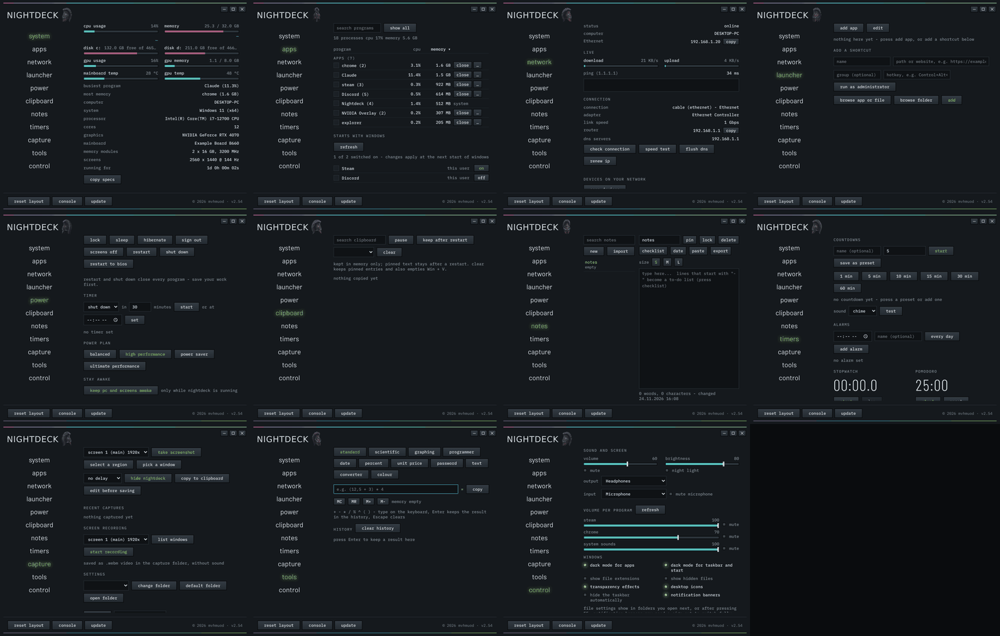
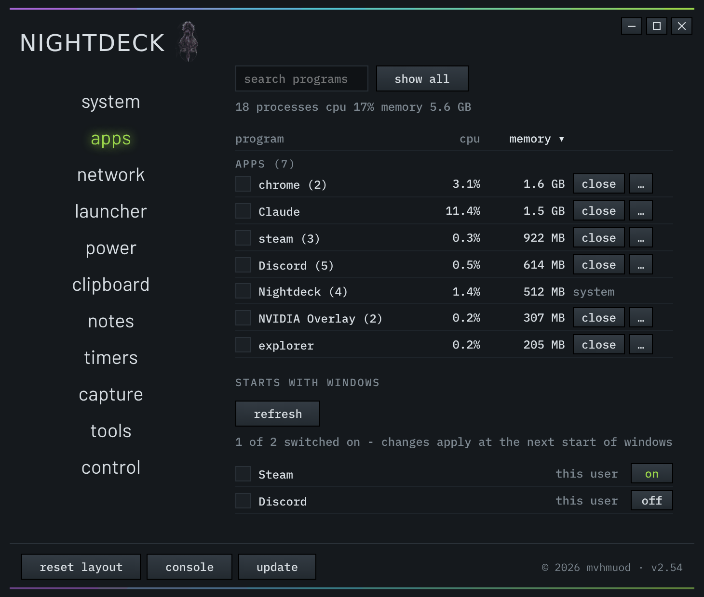
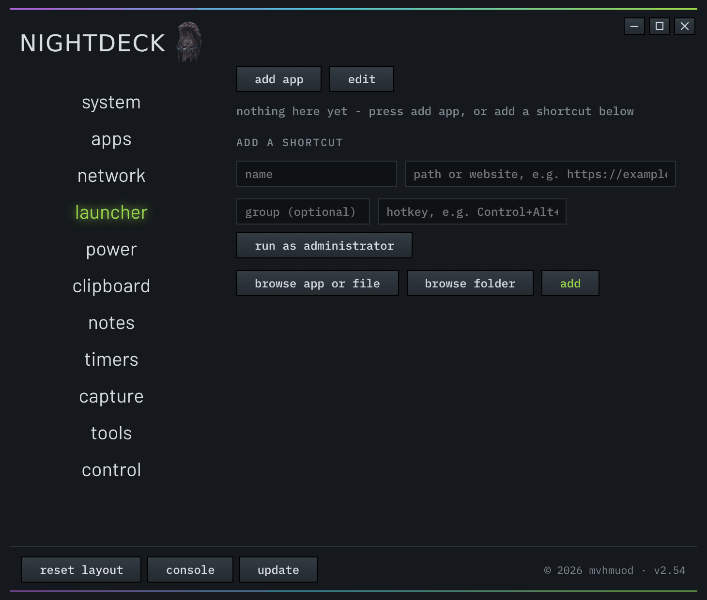
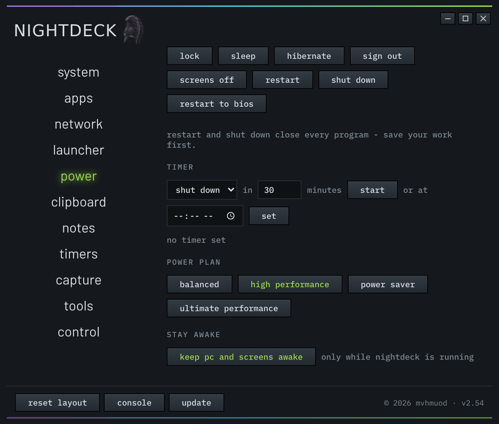
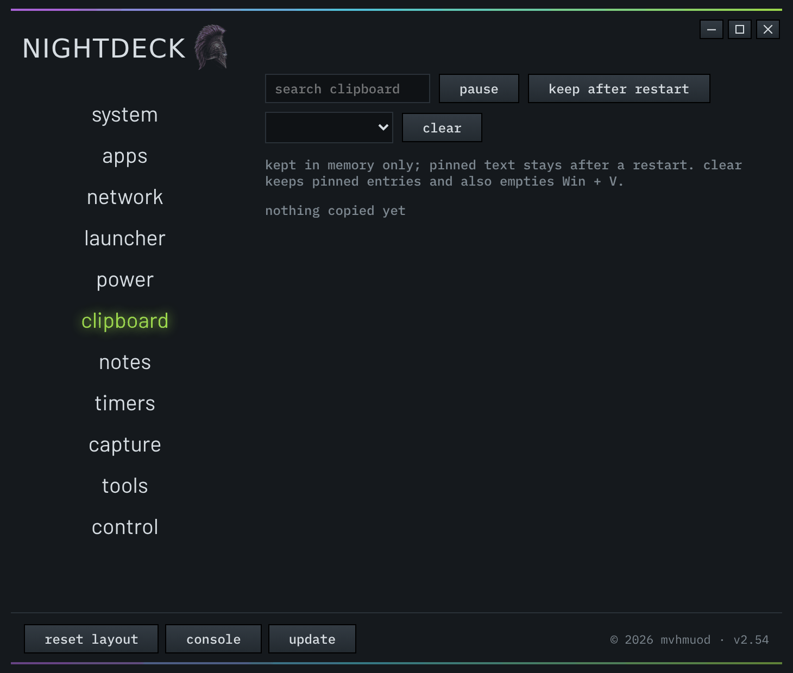
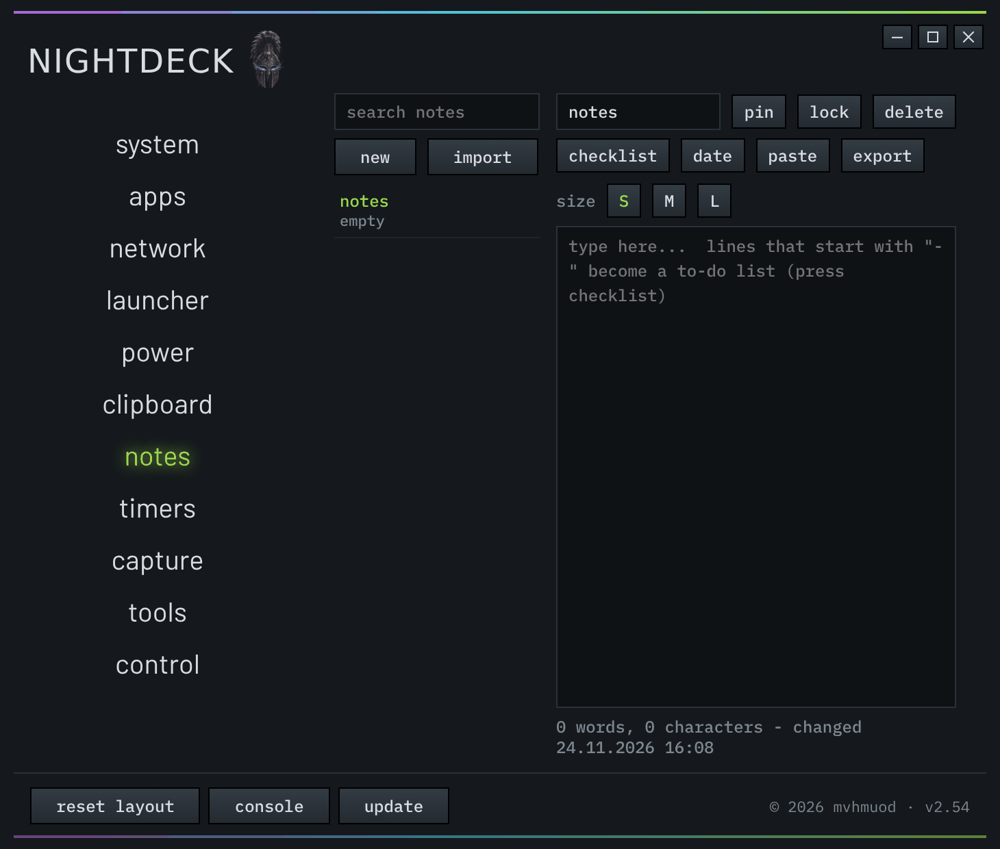
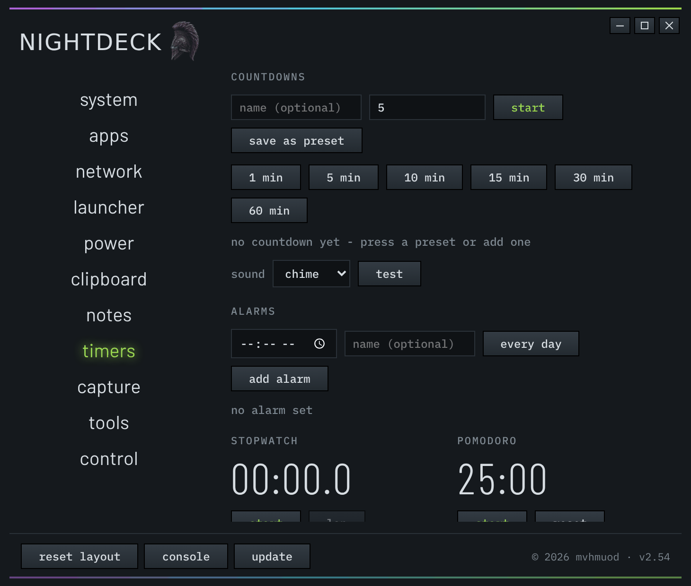
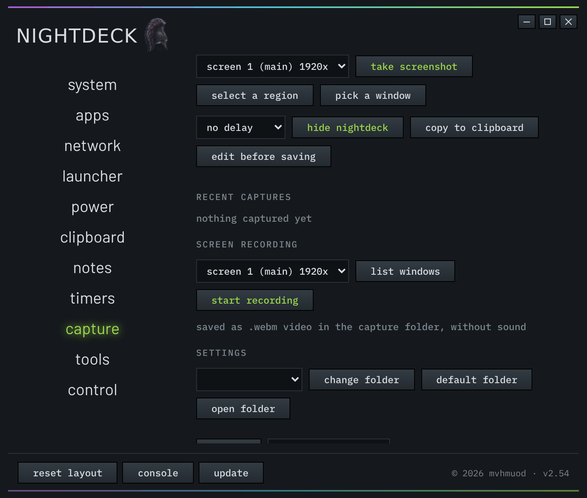
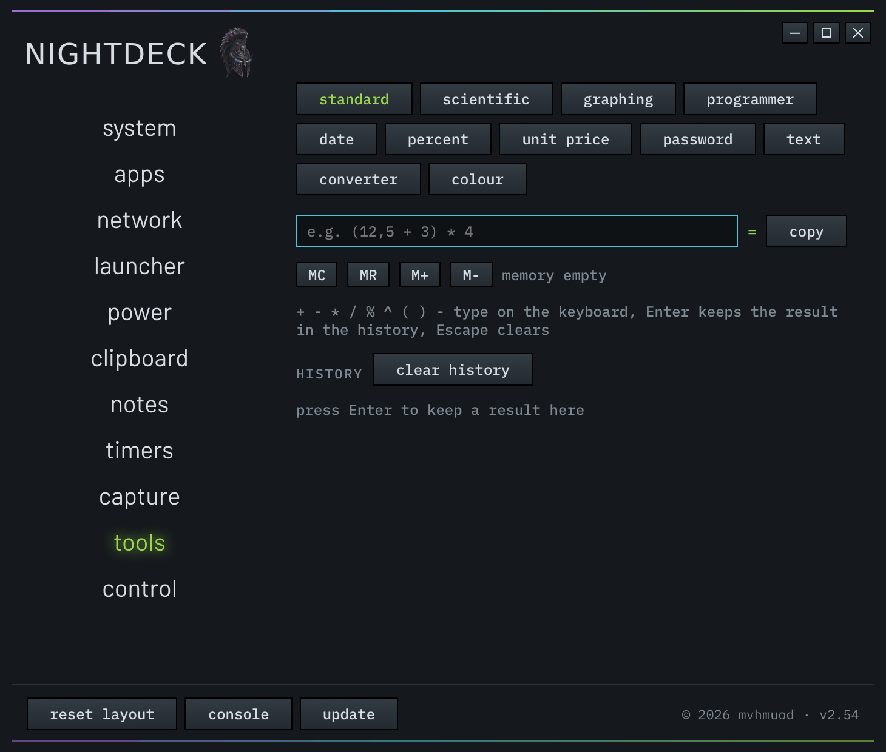

# Nightdeck

A dark control-panel style PC utility for Windows, built with Electron. One window with text tabs on the left, plus a separate console panel that stays glued to its right side and logs everything the app does.


Current version: **v2.54**. The full history is in [CHANGELOG.txt](CHANGELOG.txt).

## What it does

| Tab | What is in it |
| --- | --- |
| system | Live CPU and memory bars with history, a bar per drive, GPU usage, GPU memory and temperatures, busiest program, hardware details |
| apps | Running programs with icons, search, sorting, apps and background groups, close and force close, plus a list of what starts with Windows |
| network | Live download / upload bars, live ping with history, connection details, speed test, flush DNS, renew IP, device scan |
| launcher | Your own shortcuts with icons for programs, folders and websites: pick from installed apps, groups with "start all", reorder, run as administrator, global hotkeys |
| power | Lock, sleep, hibernate, sign out, screens off, restart, shut down (each asks first), a timer, power plans, keep awake |
| clipboard | Clipboard history for text and pictures with search, pinning, pause, quick text tools and optional saving |
| notes | Several notes with search, pinning, checklists, export and import, a backup file, and a cover for private notes |
| timers | Several countdowns with presets, alarms, stopwatch with laps, pomodoro, repeating finish sound |
| capture | Screenshots of a screen, all screens, a window or a region, with delay, clipboard copy, mark-up editor, hotkey, recent list, and screen recording |
| tools | Standard, scientific, graphing and programmer calculators with history and memory, multi-function graphing with zoom, date calculation, percent and VAT, unit price comparison, password generator, text tools, a converter with 13 categories and favourites, colour picker with screen picking and palette |
| control | Volume, sound devices and per-program volume, brightness, night light, Windows switches, Wi-Fi and Bluetooth, wallpaper, drives, cleanup, Windows settings shortcuts, and Nightdeck options with backup and restore |

Bars are blue up to 50%, red above 50% and gold at 100%. The footer shows "© 2026 mvhmuod" next to the version; the name links to this GitHub profile.

## Folders

| Folder | Contents |
| --- | --- |
| `utility/` | The current app (v2.x). This is the code Electron runs. |
| `original/` | The first panel app, finished at v1.21 and kept unchanged. |
| `sdk/` | The reusable panel kit (plain HTML, CSS, JavaScript) the apps grew out of. A cleaned-up version is published as [nightdeck-ui](https://github.com/mvhmuod/nightdeck-ui). |
| `docs/screenshots/` | Pictures of the tabs. |

Inside `utility/`:

- `main.js` - windows and everything that talks to Windows
- `preload.js` - the bridge between the two
- `index.html` - tab list and version number
- `nightdeck.js`, `nightdeck.css` - the panel library
- `tools.js`, `tools.css` - the tool tabs
- `console.html` - the console panel

## Running it

Nightdeck is made for Windows 11. You need [Node.js](https://nodejs.org).

```
cd utility
npm install --no-save electron@33
npx electron .
```

Most system features (temperatures, volume, Windows switches, network details) only work on Windows. On other systems those readings say so.

The packaged program files (`Nightdeck.exe` and the Electron runtime) are not in this repository because of their size.

## Screenshots



| | |
| --- | --- |
|  |  |
|  |  |
|  |  |
|  |  |
|  |  |

All pictures are from v2.54 with made-up sample values (computer name, addresses and hardware are examples), so they show no real PC.

## Contributing

Ideas, bug reports and pull requests are welcome.

- Found a bug or have an idea? [Open an issue](https://github.com/mvhmuod/nightdeck/issues).
- Want to change something? Fork the repo, make your change in `utility/`, try it with `npx electron .`, and open a pull request. Please bump the version in `utility/index.html` and add a line to `CHANGELOG.txt`.
- Keep the style: plain JavaScript, no frameworks, short lowercase labels, and everything that changes Windows asks first or can be undone.

## License

© 2026 mvhmuod ([github.com/mvhmuod](https://github.com/mvhmuod)).

Nightdeck is free software under the **GNU General Public License v3.0** (see [LICENSE](LICENSE)). You may use, study, change and share it, but any copy or changed version you share must also be released under GPL-3.0, with its source code and this copyright notice.

The Electron runtime that the packaged app ships with keeps its own MIT license.
