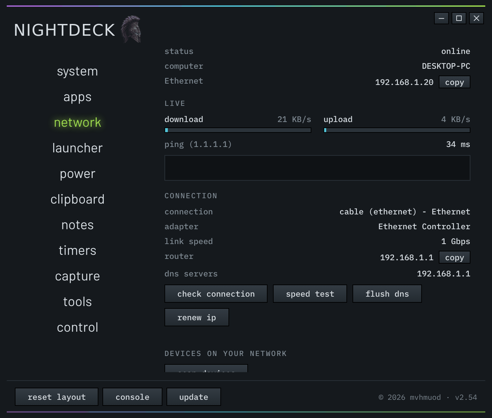
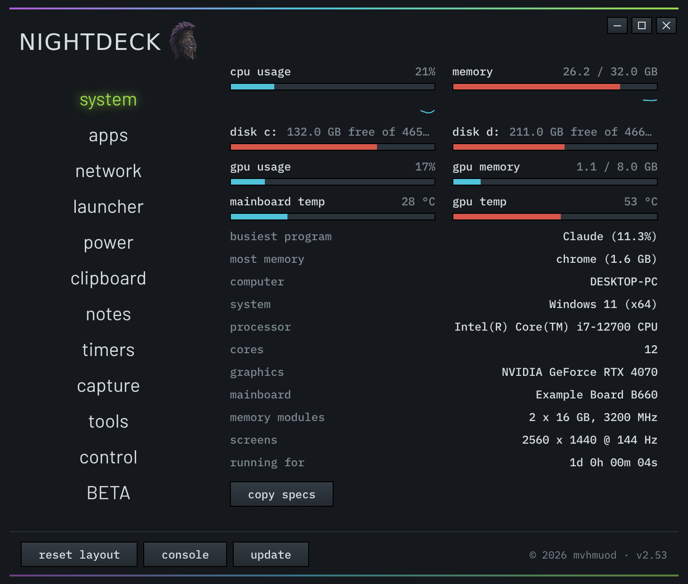
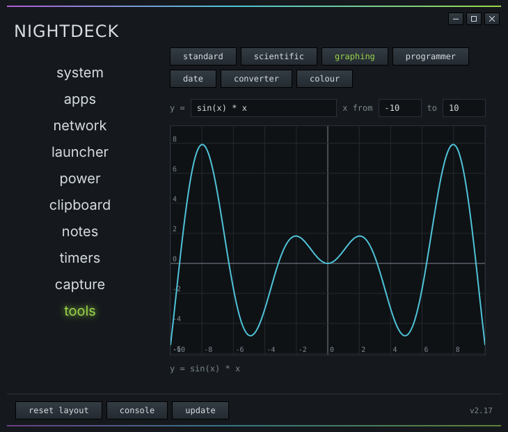
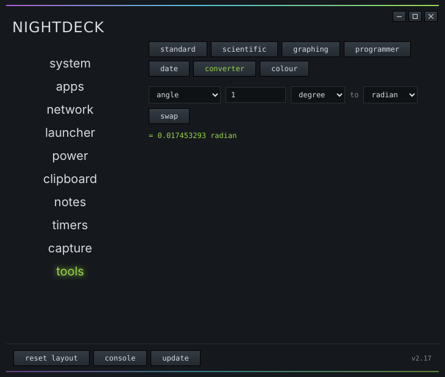
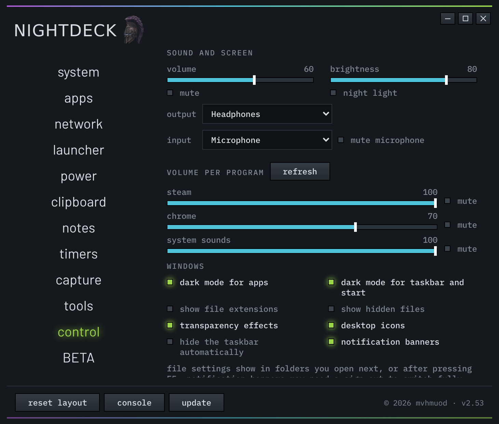
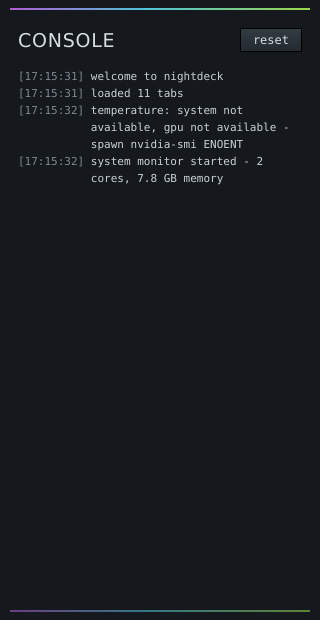

# Nightdeck

A dark control-panel style PC utility for Windows, built with Electron. One window with text tabs on the left, plus a separate console panel that stays glued to its right side and logs everything the app does.



Current version: **v2.40**. The full history is in [CHANGELOG.txt](CHANGELOG.txt).

## What it does

| Tab | What is in it |
| --- | --- |
| system | Live CPU and memory bars with history, a bar per drive, GPU usage, GPU memory and temperatures, busiest program, hardware details |
| apps | Running programs with icons, search, sorting, apps and background groups, close and force close, plus a list of what starts with Windows |
| network | Live download / upload bars, live ping with history, connection details, speed test, flush DNS, renew IP, device scan |
| launcher | Your own shortcuts with icons for programs, folders and websites: pick from installed apps, groups with "start all", reorder, run as administrator, global hotkeys |
| power | Lock, sleep, hibernate, sign out, screens off, restart, shut down (each asks first), a timer, power plans, keep awake |
| clipboard | Clipboard history for text and pictures with search, pinning, pause, quick text tools and optional saving |
| notes | Several notes with search, pinning, checklists, export and import, a backup file, and a cover for private notes |
| timers | Several countdowns with presets, alarms, stopwatch with laps, pomodoro, repeating finish sound |
| capture | Screenshots of a screen, all screens, a window or a region, with delay, clipboard copy, mark-up editor, hotkey, recent list, and screen recording |
| tools | Standard, scientific, graphing and programmer calculators with history, date calculation, percent and VAT, a converter with 13 categories and favourites, colour picker with screen picking and palette |
| control | Volume, brightness, Windows switches (dark mode, file extensions, hidden files), cleanup, tray icon, global hotkey, start with Windows |
| BETA | Empty, reserved for experiments |

Bars are blue up to 50%, red above 50% and gold at 100%.

## Folders

| Folder | Contents |
| --- | --- |
| `utility/` | The current app (v2.x). This is the code Electron runs. |
| `original/` | The first panel app, finished at v1.21 and kept unchanged. |
| `sdk/` | The reusable panel kit (plain HTML, CSS, JavaScript) the apps grew out of. |
| `docs/screenshots/` | Pictures of the tabs. |

Inside `utility/`:

- `main.js` - windows and everything that talks to Windows
- `preload.js` - the bridge between the two
- `index.html` - tab list and version number
- `nightdeck.js`, `nightdeck.css` - the panel library
- `tools.js`, `tools.css` - the tool tabs
- `console.html` - the console panel

## Running it

Nightdeck is made for Windows 11. You need [Node.js](https://nodejs.org).

```
cd utility
npm install --no-save electron@33
npx electron .
```

Most system features (temperatures, volume, Windows switches, network details) only work on Windows. On other systems those readings say so.

The packaged program files (`Nightdeck.exe` and the Electron runtime) are not in this repository because of their size.

## More screenshots

| | |
| --- | --- |
|  |  |
|  |  |
|  |  |

These six pictures are from v2.18 on a test machine, so some readings are empty and the newer title animation is missing.

## Status

A personal project by mvhmuod. No licence has been chosen yet, so all rights are reserved.
